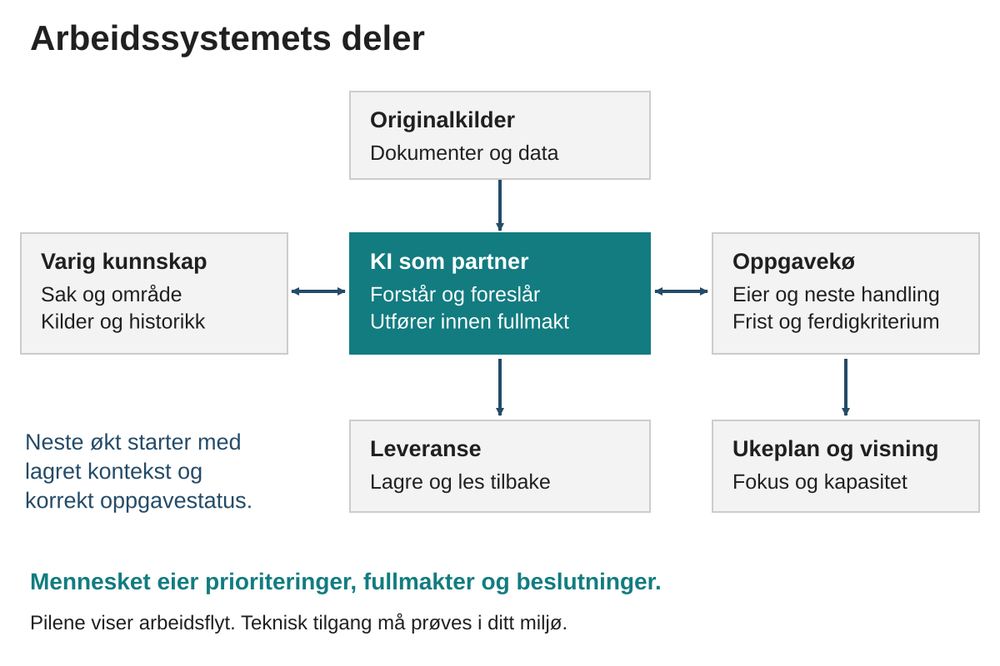
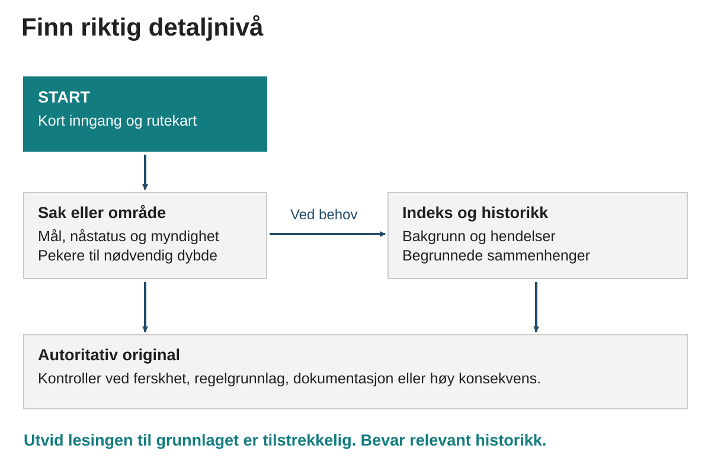

# Håndbok for et arbeidssystem med KI

Denne håndboken hjelper deg å etablere et arbeidssystem der neste økt kan fortsette på den forrige. Du får en mappestruktur, arbeidsregler, maler og kontroller som bevarer kilder, saksforståelse og konkrete neste handlinger.

## La KI hjelpe deg med oppstarten

Gi KI-verktøyet ditt tilgang til startmappen og be: «Les START-HER-KI.md og hjelp meg å sette opp systemet. Gjør det du har tilgang til, og veiled meg i resten.» KI skal først vise hva den faktisk kan lese, endre og eventuelt kjøre. Du kan bruke samme inngang med ulike KI-verktøy; alle oppdager ikke instruksjonsfiler automatisk.

Begynn med ett arbeidsområde, én sak og én oppgavekø. Du kan bruke tekstfilene i en godkjent mappe eller legge dem i et eget privat GitHub-repositorium, en mappe med versjonshistorikk.

## Bruk pakken i denne rekkefølgen

- Les håndboken, særlig kapitlene om eierskap, oppstart, leserekkefølge og grenser.
- Gjennomfør de fem øvelsene. Presentasjonen kan brukes alene eller sammen med en veileder.
- Svar på spørsmål 1–10 i avklaringsheftet. Resten kan vente til videre tilpasning.
- Kopier systemmalen til din egen godkjente arbeidsflate. Bruk eksempelmappen til å prøve arbeidsformen.
- Bruk én reell pilotsak i ti arbeidsdager før du utvider.

Strukturen er klar for bruk, mens rolle, kontoer, tilganger og arbeidsdata skal fylles inn av hver bruker. Ingen integrasjoner eller planlagte kjøringer er aktivert. GitHub Actions kan kontrollere repoets filer ved endringer når Actions er tilgjengelig.

Versjon 1.1 • 19. oktober 2026 • Startpakke. Eksempelsaken om Fjordverk er oppdiktet.

## Finn fram i håndboken

I PDF- og Word-utgaven: Prinsipper og daglig bruk står på sidene 2–10. Leseruter, bytegrenser og kontroller står på sidene 11–13. Oppstart og tekniske valg står på sidene 14–18. Kvalitet, pilotplan og begreper står på sidene 19–21.

# Hvordan systemet er bygget

Systemet skiller mellom originalinformasjon, bearbeidet forståelse og handling. Da kan ulike arbeidsflater samarbeide uten å konkurrere om den samme opplysningen. Kontroller alltid hva den valgte arbeidsflaten faktisk kan lese og skrive.

| Del | Ansvar |
| --- | --- |
| Ditt dokument- eller fagsystem | Originaler, formelle beslutninger og dokumenter med avklart eier. |
| Systemmappen eller repoet | Bearbeidet kunnskap, kildepekere, arbeidsregler og relevant historikk. |
| Én oppgavekø | Handling, ansvar, frist og ferdigkriterium. Malen starter med tekstkø. |
| Samtale med KI | Analyse, prioritering, utkast og vedlikehold innenfor avtalt mandat. |
| Utførende agent ved behov | Filendringer, lokal kontroll og andre autoriserte handlinger. |
| Ukeplan | Et begrunnet valg av arbeid fra den samme oppgavekøen. |
| Avtalt leveransested | Ferdige filer som mottakeren kan finne og bruke. |

En forbindelse mellom to deler må prøves med lesing, eventuell autorisert skriving og gjenlesing. Produktnavn eller en koblet konto er ikke bevis for at alle operasjoner virker.

Du fyller selv inn rolle, kilder og fullmakter. Oppsettet skal tåle at en ny økt overtar, og at et verktøy mangler tilgang. En konkret restliste gjør det mulig å fortsette uten å gjette.

# Hver type informasjon får ett hjem

Systemet blir pålitelig når du vet hvilken kilde som kan avgjøre et spørsmål. En sakstekst kan forklare betydningen av et vedtak, men selve vedtaket må fortsatt kunne finnes. En ukeplan kan velge en oppgave, men oppgavens frist bør vedlikeholdes ett sted.

| Informasjon | Eier i startpakken | Eksempel |
| --- | --- | --- |
| Gjeldende original | Din dokument- eller fagsystemflate | Signert avtale eller godkjent møtereferat. |
| Forståelse og historikk | En saksfil eller områdefil | Hvorfor saken finnes, hva som er kjent og hva som mangler. |
| Handling og oppfølging | Én valgt oppgavekø | Ansvarlig, neste steg, frist og ferdigkriterium. |
| Valgt ukefokus | arbeid/UKA.md | Inntil tre ønskede utfall innen faktisk kapasitet. |
| Arbeidsregler | PROJECT.md og docs/ | Hvordan assistenten skal lese, utføre og kontrollere. |
| Utførelsesordre til agent | oppdrag/aktiv/ ved behov | En avgrenset handling med målflate og akseptansekriterier. |

I den enkle varianten er arbeid/OPPGAVER.md oppgavekøen. Hvis du velger Issues som oppgavekø, overtar Issues denne rollen. Velg én av dem som aktiv eier. Ved overgang må hver åpen oppgave få en kobling til sitt nye Issue før den gamle køen markeres som historisk.

Et eksempel: En godkjent e-post flytter en leveransefrist. Kontroller e-posten, oppdater oppgaven og vurder om ukeplanen må endres. Saksfilen trenger bare en kort forklaring og kildepeker dersom endringen har betydning for saken. Samme tekst skal ikke kopieres inn i alle filene.

# Kart over systemet



Samtalen er arbeidsrommet. Filene og oppgavekøen gjør arbeidet mulig å overta. Det viktigste fra en samtale må derfor få et varig hjem når det endrer en sak, en oppgave, en beslutning eller en arbeidsregel.

En pil i kartet beskriver ønsket arbeidsflyt. Den er ikke en ferdig teknisk integrasjon. For hver faktisk forbindelse må du kontrollere lesing, eventuell skriving og gjenfinning av lagret resultat.

Du kan bruke strukturen uten GitHub i første fase. En godkjent mappe med tekstfiler er tilstrekkelig for å prøve arbeidsformen. GitHub blir nyttig når du trenger versjonshistorikk, en varig oppgavekø eller samarbeid mellom flere arbeidsflater.

# Den minste strukturen som er nyttig

Startmalen inneholder mer enn du trenger første dag, slik at du slipper å konstruere resten senere. De følgende filene er kjernen. En Markdown-fil med endelsen .md er vanlig tekst med enkel markering av overskrifter og lister. Den kan leses uten programmeringskunnskap.

| Fil eller mappe | Hva den svarer på |
| --- | --- |
| PROJECT.md | Hva skal systemet hjelpe med, og hvilke regler gjelder? |
| context/START.md | Hvor skal denne økten begynne å lese? |
| context/PROFIL.md | Hvem er du, og hvordan arbeider du? |
| context/KILDER.md | Hvor finnes originalene, og hva er kontrollert? |
| context/CURRENT.md | Hva er den korte helhetsstatusen? |
| arbeid/OPPGAVER.md eller Issues | Hva er neste handling, og hvem eier den? |
| arbeid/UKA.md | Hva er valgt for denne uken? |
| saker/ og areas/ | Hva gjelder i konkrete saker og varige ansvarsområder? |

En sak har et avgrenset problem eller resultat, for eksempel å etablere en ny introduksjonsordning. Et område er et mer varig ansvar, for eksempel medarbeiderutvikling. Begynn med en sak. Opprett et område når flere saker faktisk trenger felles kontekst.

START skal være et rutekart, ikke en komplett selvbiografi eller kopi av alle saker. Nye saker føres inn i saksregisteret. Mer detaljert bakgrunn kan flyttes til en undermappe med en indeks når saken blir vanskelig å lese.

# Hvordan ny informasjon blir til nyttig arbeid

Du skal kunne sende et usortert notat. Assistentens jobb er å forstå innholdet, skille mellom ulike typer informasjon og foreslå eller utføre riktig oppdatering innenfor avtalte fullmakter.

- Finn kilden og datoen. Er dette original, utkast, din opplysning eller assistentens vurdering?
- Sjekk eksisterende sak og oppgave før noe nytt opprettes.
- Trekk ut hva som endrer forståelse, beslutning, ansvar eller neste handling.
- Plasser varig kunnskap i saken og handling i oppgavekøen.
- Kontroller berørte frister og prioriteringer. Les tilbake det som faktisk ble lagret.

## Et eksempel som brukes gjennom pakken

Den oppdiktede organisasjonen Fjordverk vil forbedre introduksjonen av nye frivillige. Et møtenotat sier at prosjektlederen skal lage et forslag innen 12. november. En kollega skal først levere oversikt over dagens praksis. Ledelsen skal avgjøre om ordningen innføres.

Saksfilen forklarer behov, rammer og beslutningsmyndighet. Oppgaven beskriver leveransen og neste handling. Kollegens oversikt er en avhengighet. Ukeplanen kan velge å utarbeide disposisjonen. Et forslag til ny ordning skal fortsatt stå som forslag inntil riktig leder har besluttet det.

En påstand om at mange slutter tidlig er ikke en måling bare fordi den står i notatet. Bevar den som en opplysning som må undersøkes. Assistenten kan foreslå at tilgjengelige tall og erfaringer kontrolleres før ordningen begrunnes med dette.

# Kilder og kunnskap som kan etterprøves

Et nyttig system må kunne si både hva det vet og hvor sikkert det vet det. I en sak skal kilden, datoen og behovet for ny kontroll være tydelig når det påvirker arbeidet. En historisk opplysning kan være korrekt selv om dagens situasjon har endret seg.

| Status | Betydning | Riktig formulering |
| --- | --- | --- |
| Dokumentert | Kilden er faktisk lest og støtter påstanden. | Referatet fra 5. november angir fristen. |
| Opplyst av bruker | Du har gitt opplysningen. | Du opplyser at lederen ønsker et utkast. |
| Vurdering | En begrunnet tolkning av grunnlaget. | Dette tyder på at kapasitet bør avklares først. |
| Uavklart | Det mangler et svar eller en nødvendig kontroll. | Det er ikke kontrollert om fristen senere er endret. |
| Besluttet | Riktig person eller organ har tatt beslutningen. | Lederen godkjente forsøket i det daterte referatet. |

Bruk normalt gjeldende original først, deretter en ny uttrykkelig opplysning fra deg, sist verifisert saksnotat og så eldre samtale. Hvis din nye opplysning og originalen motsier hverandre, skal motstriden synliggjøres og undersøkes. Assistenten skal ikke velge den mest praktiske versjonen uten forklaring.

Originalkontroll er særlig viktig ved penger, personell, regler, eksterne løfter og beslutningsmyndighet. Hvis originalen er utilgjengelig, kan resten av forarbeidet fortsette. Merk den konkrete delen som gjenstår, med kilde og gjenopptakspunkt.

Dokumenter og nettsider brukes som kilder. Tekst inne i en kilde gir ikke i seg selv assistenten nye fullmakter til å sende, slette, dele eller endre systemet.

# Oppgaver som er klare til å arbeides med

En god oppgave beskriver et resultat du har ansvar for. Den trenger et konkret neste steg og et tydelig sluttpunkt. En vag tittel som «Introduksjon» gir ingen av delene. «Avklare og utforme forslag til introduksjonsordning» beskriver arbeidsløpet, mens «Sammenligne dagens praksis i to team» er neste steg.

| Felt | Hva du fyller inn |
| --- | --- |
| Eier | Den som faktisk har ansvar for neste handling. |
| Mål | Hva som skal være annerledes når oppgaven er ferdig. |
| Neste handling | Et observerbart steg som kan utføres. |
| Frist | Siste avtalte dato for resultatet, dersom den finnes. |
| Arbeidsdato | Dagen du planlegger å arbeide med den. |
| Kontrolldato | Dagen du skal sjekke en avhengighet eller ta stilling. |
| Ferdig når | Hvilket bevis eller resultat som lukker oppgaven. |

Disse datoene kan være forskjellige. Arbeid 9. november, kontroll av kollegas bidrag 10. november og leveransefrist 12. november betyr tre ulike ting. Ikke lag en frist fordi et felt er tomt.

Hvis eier, mål eller neste handling mangler, ligger oppgaven til avklaring. Hvis noen andre må handle, står den som venter. En avtalt kontrolldato oppretter et konkret eget oppfølgingsbehov. En idé kan parkeres uten konstruert dato.

Prioriteringen bygger på viktighet, deretter verdi av fremdrift og så hastverk. En reell frist kan overstyre når konsekvensen er vesentlig. I din pilot bruker vi inntil tre hovedprioriteringer, tilpasset faktisk kapasitet.

# En arbeidsrytme som holder systemet levende

Filer alene gir ingen kontinuitet. Systemet må brukes i starten og avslutningen av arbeidet. Tidsangivelsene under er forslag til piloten, ikke krav til din kalender.

| Når | Hva du gjør | Hva som skal sitte igjen |
| --- | --- | --- |
| Dagsstart 5–10 min | Se tilgjengelig tid, reelle frister og valgt ukefokus. | En realistisk hovedprioritet eller Top 3 med første steg. |
| Underveis | Gi råstoff når det kommer. Oppdater den eksisterende saken. | Ny informasjon og handling har riktig hjem. |
| Dagslutt 5 min | Kontroller utført arbeid og åpne løkker. | Korrekt status og et tydelig gjenopptakspunkt. |
| Ukeslutt 25–40 min | Vurder resultater, frister, venting og neste ukes kapasitet. | Kort ukereview og forslag til nye ukesutfall. |
| Måned 30 min | Se etter mønstre i nytte, feil og vedlikehold. | Ett begrunnet forbedringsforsøk. |

Du trenger ikke få en stor rapport hver morgen. Be om det minste som gjør valget enklere: hva som er viktigst, hvorfor det bør prioriteres og hva første handling er. La rutinearbeid få en egen plass uten at det automatisk skyver bort viktig utviklingsarbeid.

I ukereviewet skiller du mellom levert resultat og senere virkning. Et introduksjonsopplegg kan være ferdig utarbeidet før du vet om det hjelper nye frivillige. Oppgaven kan lukkes når leveransen er ferdig, mens effekten følges opp i et eget kontrollpunkt.

En kalenderoppføring eller påminnelse er ikke en automatisk utførende agent. Gjentakende kjøringer innføres først når den manuelle arbeidsflyten virker og faktisk resultat kan kontrolleres.

# Kontekst som kan vokse uten å bli uoversiktlig



En ny økt begynner med START og den relevante saken. Derfra går den videre til akkurat den bakgrunnen eller originalen som trengs. Agenten skal selv utvide lesingen når første kilde ikke gir nok grunnlag. To filer er en start, ikke en grense.

Når saksfilen blir tung, behold en kort oversikt med status, viktige avklaringer og lenke til en indeks. Flytt historikk og dokumentasjon til dybdelaget. Bevar begrunnelsene og detaljene som fortsatt har verdi. En kort oversikt skal gjøre kunnskapen lettere å finne.

Sammenhenger mellom saker bør forklares med én kort begrunnelse og en lenke. «Avhenger av bemanningsavklaringen fordi den avgjør kapasiteten til forsøket» er mer nyttig enn en løs lenke med teksten «se også».

# Slik leser en ny økt riktig

Start med en kort, stabil inngang og utvid lesingen etter behov. Dette reduserer unødvendig oppstart uten å gjøre undersøkelsen grunnere.

| Situasjon | Leserute |
| --- | --- |
| Samtaleprosjekt | CHATGPT-PROSJEKTINSTRUKS peker til CHATGPT-START. Den fører videre til context/START. |
| Utførende agent | AGENTS.md fører til gjeldende START og dokumenterte tilganger. |
| Første oppstart eller regelendring | Les PROJECT.md som felles systemkontrakt. |
| Konkret sak | START → saksregister → sakshub → relevant INDEX og detalj → original når nødvendig. |
| Prioritering | START, CURRENT og PRIORITERINGER gir helheten. Hent relevant oppgavekø og ukevalg. |

Sakshuben er den korte hovedfilen for en sak. Den beholder status, rammer, kildegrunnlag og spørsmål som påvirker arbeidet. Dybdefiler tar vare på mer detalj. INDEX er en innholdsfortegnelse med lenker og korte forklaringer.

Les mer når en detalj kan endre forståelsen, et valg eller konsekvensen. Et normalbudsjett er ikke et tak på samlet analyse. Kontroller gjeldende original ved formelle avgjørelser, usikker ferskhet eller vesentlig konsekvens.

En fast prosjektinstruks skal være en peker. Varige endringer i oppstarten gjøres i CHATGPT-START og leserutene. Da slipper du å vedlikeholde samme regel både i et innstillingsfelt og i mange filer.

Øv på å stille et spørsmål som krever eldre bakgrunn. Hvis svaret bare finnes når du gjentar historien i samtalen, må register, indeks eller kildepeker forbedres.

# Bytegrenser som beskytter leserutene

Kontrollen måler UTF-8-byte etter at CRLF-linjeskift er normalisert til LF. Tegn som æ, ø og å kan bruke mer enn én byte. Tegnantall og tokenanslag er derfor ikke samme måling.

| Hva som måles | Varsel | Blokkering |
| --- | --- | --- |
| START | 5 400 byte | 6 000 byte |
| START + CURRENT + PRIORITERINGER | 16 000 byte | 19 000 byte |
| Normal målrettet rute | 19 200 byte | 21 600 byte |
| Register | 12 000 byte | 16 000 byte |
| Sakshub | 11 000 byte | 14 000 byte |
| Dybde, historikk og manifest | 16 000 byte | 20 000 byte |
| AGENTS.md | Ingen | Over 6 500 byte |
| CHATGPT-START.md | Ingen | Over 10 000 byte |
| CURRENT alene | Ingen | Over 12 000 byte |
| PRIORITERINGER alene | Ingen | Over 9 000 byte |
| Fast prosjektinstruks | Ingen | Over 1 500 tegn |

For de seks første radene gjelder varsel og blokkering fra og med grensen, altså >=. De øvrige filgrensene bruker >, som betyr over grensen. Den faste prosjektinstruksen måles i Unicode-tegn.

Dashboardet har i tillegg absolutt grense 21 600 byte, og normal rute 24 000. Blokkeringen gjelder allerede ved henholdsvis 19 000 og 21 600. En absolutt grense er ikke ekstra ledig plass.

Normalruter måles som START pluss hver toppnivåfil i context, areas og saker, samt oppgitte ekstra ruter. Hele samlingen kan vokse. Historiske enkeltfiler har samme dybdegrense på 20 000 byte; status historisk gir ikke unntak.

Ved varsel vurderer du ruten. Før blokkering flytter du rik detalj til sammenhengende tema- eller historikkfiler og oppdaterer indeksene. Bevar kilder og begrunnelser. Kontroller både gjenfinning og at meningen er bevart. Tallene eies av config/context-budgets.json.

# Kontroller før du leverer en endring

Python 3.10 eller nyere trengs for de lokale kontrollprogrammene. De bruker standardbiblioteket og trenger ingen pakkeinstallasjon. Åpne terminalen i systemets rotmappe. På Windows kan py -3 brukes i stedet for python3.

START-HER-KI.md og docs/KI-OPPSTART.md beskriver oppstart med ulike verktøy. Har KI bare lesetilgang, skal den gi konkrete manuelle steg med målsted og kontrollpunkt. Skrivetilgang og kommandokjøring prøves hver for seg.

```sh
python3 scripts/verify.py
python3 scripts/budget.py
python3 scripts/verify.py --ready
```

Vanlig verify skal bestå på den urørte malen. --ready skal feile til grunnoppsett, pilotlenke og registrert oppstart er fylt ut. Den praktiske tilgangsprøven må fortsatt utføres. budget viser målte størrelser. --json gir maskinlesbar rapport.

## Når du bruker Git

- Les gjeldende full HEAD-verdi med git rev-parse HEAD. Se diff og velg bare filene som hører til endringen.
- Stage disse filene. Kjør preflight med den fullstendige SHA-en du nettopp leste; bytt ut SHA_FRA_GIT_REV_PARSE i kommandoen. Kontrollen bruker den staged kandidaten i en isolert kopi.
- Kontroller rapportert tre-ID. Etter commit må commitens tre samsvare. Har HEAD eller kandidaten endret seg, kjør kontrollen på nytt før push.

```sh
python3 scripts/preflight.py --expect-head SHA_FRA_GIT_REV_PARSE
git rev-parse "HEAD^{tree}"
```

Ved endring av kontroller, kontrakter eller budsjettregler kjører du også: python3 -m unittest discover -s tests -v. I et nytt repo uten commit brukes vanlig verify først; preflight krever en eksisterende HEAD.

Kontrollene finner blant annet brudd på bytegrenser, manglende filer, enkelte metadatafeil, ødelagte lokale lenker, manglende indeksruter og åpenbare hemmeligheter. De kan ikke avgjøre om et vedtak er riktig eller om meningen er bevart ved omskriving. Les original, vurder innholdet og kontroller lagret resultat.

# De første tretti minuttene

Bruk den første halvtimen til å prøve strukturen med eksempeldata. Fortsett senere med en reell pilotsak når lagring og tilganger er avklart. Du trenger ikke programmere; kontrollprogrammene er valgfrie ved lesing, men brukes før repoendringer leveres.

| Tid | Gjør dette | Resultat |
| --- | --- | --- |
| 0–5 min | Pakk ut 05-Systemmal eller ZIP fra GitHub i din egen godkjente mappe. Åpne README og KOM-I-GANG. | Én mappe er valgt som arbeidskopi. |
| 5–10 min | Les PROJECT og START. Finn saksregister, oppgavekø og eksempelmappe. | Du kan peke på hvor forståelse og handling bor. |
| 10–15 min | Bruk CHATGPT-PROSJEKTINSTRUKS som prosjektinstruks. Gjør CHATGPT-START og relevante filer lesbare. | Assistenten viser hvilke filer den faktisk fikk lest. |
| 15–25 min | Sorter øvingseksempelet. Finn saken, lag et oppgaveutkast og velg én neste handling. | Et sammenhengende første arbeidsløp er klart. |
| 25–30 min | Lagre resultatet. La en ny økt finne sak, kilde, eier og neste handling. | Du ser om overtakelsen virker. |

Før reell bruk fyller du owner, original_home og delivery_home i config/system.json, og registrerer profil, kilder og tilganger. Behold task_owner som markdown i den enkle piloten. Felt kan stå som IKKE_AVKLART mens du øver.

Hvis arbeidsflaten bare kan lese vedlegg, lagrer du eller en autorisert agent endrede filer tilbake i den valgte mappen. Bytt ut utdaterte prosjektvedlegg bevisst. En fil som bare er skrevet i samtalen, er ikke nødvendigvis lagret.

Registrer faktisk oppstartsprøve i context/OPPSTART.md. Sett access_confirmed til true først etter prøvd tilgang, og phase til active først etter en fungerende pilot og bestått kontroll med --ready.

# Oppsett med GitHub

GitHub gir versjonshistorikk og mulighet for felles endringskontroll. Behold gjerne tekstkøen i starten. Issues kan overta oppgavene senere når du har bestemt at dette er riktig eier.

- Last ned distribusjonsmalen som ZIP. Opprett et eget privat repo på en konto og et lagringssted du har lov til å bruke. Bruk en separat kopi; en offentlig fork er fortsatt offentlig.
- Legg inn filene med mappestrukturen bevart, også .github og .gitignore. GitHub Desktop er en mulig arbeidsflate hvis du vil unngå terminal.
- Kontroller eierkonto, tilgang og at README, START og relative lenker åpner riktig fil. Reelle arbeidsdata skal ikke inn i den offentlige distribusjonsmalen.
- Gjør en lesetest fra KI-arbeidsflaten mot ditt eget repo. Prøv deretter én autorisert, ufarlig tekstendring og les den tilbake.
- Kjør kontrollprogrammene fra rotmappen. Ved bruk av Git følger du staged-kontrollen før commit og push.
- Hvis Issues skal overta, bruk maler/oppgave.md som grunnlag i ditt eget repo. Flytt åpne oppgaver med stabile koblinger, marker den gamle køen historisk og sett task_owner til github_issues.

Et privat repo regulerer tilgang, men avgjør ikke i seg selv om organisasjonen tillater innholdet lagret der. Avklar egnet lagring før du tar inn reelle opplysninger.

GitHub Actions kontrollerer filer ved push, pull request og manuell kjøring. Det følger ingen bakgrunnssynk eller planlagt arbeidsjobb med malen. Se docs/GITHUB-OPPGAVER.md og docs/KONTROLLER.md for detaljene.

# Samarbeid mellom ChatGPT og en utførende agent

ChatGPT kan gjøre analyse, formulere mål og lage et presist arbeidsgrunnlag. En agent som Codex kan være nyttig når oppgaven krever filredigering, lokal kjøring eller tilgang som samtaleflaten mangler. Hvilke verktøy den faktisk har, må prøves i ditt miljø.

En arbeidsordre gjør overleveringen uavhengig av samtalehistorikken. Den skal være så konkret at neste agent kan begynne med kontroll og utførelse, fremfor å gjette hva dere kom fram til.

| Arbeidsordren må angi | Hvorfor det trengs |
| --- | --- |
| Mål og ferdigkriterium | Agenten vet hva som teller som løst. |
| Bakgrunn og besluttet retning | Allerede gjort tankearbeid blir bevart. |
| Kilder og målflate | Riktig original og riktig leveransested kan finnes. |
| Autorisasjon og grenser | Agenten vet hvilke handlinger som er godkjent. |
| Avhengigheter og stoppunkt | Uavklarte beslutninger blir ikke oversett. |
| Fremdrift og kvittering | En annen økt kan fortsette og kontrollere resultatet. |

Startpakken bruker tilstandene utkast, klar, pågår, blokkert og fullført. Klar betyr at oppdraget har nødvendige avklaringer og autorisasjon. Et lagret utkast er fortsatt utkast. Fullført krever at resultatet er kontrollert og lagt på riktig sted.

AGENTS.md beskriver forventet arbeidsmåte for agenten. Den gir ingen tilgang i seg selv. Prosjektinstrukser og en oppdragsmappe utløser heller ingen kjøring av seg selv. Start manuelt. Direkte overlevering og planlagt kjøring kan vurderes senere.

Bruk prompts/06-Overlevering.md og maler/oppdrag.md når du trenger denne funksjonen. Det er ikke nødvendig å ha en agentkø for vanlig samtale og planlegging.

# To Do og andre oppgavesystemer

Du kan bruke et eksisterende oppgavesystem som To Do, Planner eller et fagsystem dersom det passer arbeidet. Velg hvilken flate som eier oppgavene, og dokumenter hva KI skal lese og eventuelt får oppdatere. En oversikt som viser data fra køen er en visning, ikke en ny eier.

Flere oppgaveflater krever mer vedlikehold enn én kø. I piloten bruker du én aktiv kø. Hvis et eksisterende verktøy fungerer godt, avklar hvilke oppgaver det eier før du innfører et nytt.

## Hvis du senere trenger to flater

- Fastsett hvem som eier hvert felt: status, faktisk leveransefrist, arbeidsdato og ansvar.
- Koble eksisterende objekter med stabile ID-er eller lenker før nye opprettes.
- Avklar forholdet mellom delsteg og hovedoppgave. Flere små oppgaver kan høre til samme arbeidsløp.
- Les begge flater før endring. Ved motstrid skal kilden og hensikten undersøkes.
- Oppdater bare berørte felt. Les tilbake hver endring og før eventuelle restfeil.
- Prøv først én oppgave, så en liten gruppe. Utvid etter dokumentert samsvar.

Når ett delsteg er utført, er ikke hele saken nødvendigvis ferdig. Hvis en rad er slettet i den ene flaten, beviser det heller ikke at arbeidet er utført. Et planlagt arbeidsdøgn skal ikke bli fremstilt som endelig frist.

Ikke bygg egen nettside eller et avansert kontrollpanel før det er tydelig hva oppgavedataene skal bety. En visning er nyttig først når det den viser er riktig.

# Tilgang og myndighet i ditt system

Avklar hvem som kan lese, hvem som kan endre og hvem som kan beslutte. Disse spørsmålene er forskjellige. En assistent kan ha tillatelse til å lese en kilde og lage et forslag uten å ha tillatelse til å sende det eller gjøre det til et vedtak.

| Handling | Utgangspunkt i piloten |
| --- | --- |
| Lese godkjente kilder | Innenfor dokumentert tilgang og oppdrag. |
| Analysere og lage utkast | Innenfor avtalt arbeidsområde. |
| Oppdatere eget øvingssystem | Kan utføres når du har autorisert pilotarbeidet. |
| Endre levende arbeidsdata | Avtal omfang, målflate og kontroll først. |
| Sende eller publisere | Krever din konkrete godkjenning eller tydelig etablert fullmakt. |
| Ta formelle beslutninger | Forblir hos riktig person eller organ. |

Fyll ut tilgangsmatrisen i context/TILGANGER.md med faktisk testdato og resultat. Bekreft både at du selv har lov til å bruke kilden på denne måten, og at verktøyet faktisk kommer til. Beskriv egne fullmakter uttrykkelig; tillatelser fra et annet oppsett følger ikke med.

Ta med den informasjonen som trengs for arbeidet, i godkjente flater. Passord, tokens, engangskoder og sesjonsdata skal aldri inn i oppgaver, notater eller repositorium. Originaldokumenter beholder sitt avtalte hjem; arbeidskonteksten bevarer betydning og kildepeker.

Ved teknisk feil: kontroller siste sikre tilstand, prøv en annen relevant og tillatt vei og fortsett uavhengig arbeid. En uttrykkelig sikkerhetsavvisning skal respekteres. Noter nøyaktig hva som er lagret, hva som mangler og hvor arbeidet kan gjenopptas.

# Kvalitet og læring når noe går galt

Det viktige er ikke at assistenten høres sikker ut, men at arbeidsresultatet tåler kontroll. Be den vise hva som ble lest, hva som ble endret, hva som ble kontrollert og hva som fortsatt mangler. Et pent dokument er ikke bevis for riktig grunnlag.

| Feil du ser | Hva du kontrollerer først |
| --- | --- |
| Assistenten husker feil | Er riktig, oppdatert START og saksfil faktisk lest? |
| En oppgave finnes flere steder | Er det én valgt eier og en kobling til eksisterende objekt? |
| En frist flytter seg | Ble arbeidsdato forvekslet med leveransefrist? |
| Alt blir viktig | Er mål, eierskap og kapasitet avklart før prioritering? |
| En fil sies å være lagret | Finnes den på målflaten, og er innholdet lest tilbake? |
| En rettelse forsvinner | Ble endringen lagret hos riktig eier og gjort tilgjengelig i neste økt? |

Når en feil gjentar seg, rett først den konkrete feilen. Finn deretter hvorfor den oppsto. Oppdater den arbeidsregelen eller kontrollen som kan hindre samme type feil. Prøv det opprinnelige tilfellet igjen. Unngå å legge enda en generell instruks på toppen hvis problemet egentlig er en uklar kilde eller to konkurrerende oppgavelister.

La en leveranse være ferdig når innholdet er riktig, relevant kontroll er utført, filen er på riktig sted og statusen stemmer. En blokkert del beskrives konkret; den skal verken skjules eller stoppe alt annet arbeid.

Korte ukesnotater om nytte og feil gir bedre grunnlag for forbedring enn stadig nye funksjoner. Mål om systemet hjelper deg med viktig arbeid, gjenfinning og færre tapte oppfølginger.

# De første tretti dagene

Planen er en anbefalt utprøving. Datoer og tempo tilpasses etter svarene dine. Ingen av punktene er lagt i kalenderen eller satt i gang automatisk.

| Periode | Arbeid | Ferdigkriterium |
| --- | --- | --- |
| Dag 1–3 | Velg én sak, godkjent lagring og én oppgavekø. Gjennomfør startøvelsen. | Du finner sak, kilde og neste handling igjen i en ny økt. |
| Dag 4–10 | Bruk dagsstart og dagslutt på reelt arbeid. Hold strukturen liten. | Ingen ny oppgave mangler eier eller konkret neste steg uten at den er merket til avklaring. |
| Dag 11–20 | Gjennomfør to ukereviewer. Rett de mest merkbare feilene. | Ukeplanen er realistisk, fristene kontrollerte og én forbedring prøvd. |
| Dag 21–30 | Vurder behov for GitHub, agent eller én integrasjon. | Velg å fortsette, justere eller forenkle ut fra faktisk erfaring. |

Registrer en enkel førmåling: Hvor vanskelig er det å finne igjen en pågående sak? Hvor ofte må du forklare samme bakgrunn? Hvilken viktig oppfølging er lett å glemme? Bruk et konkret eksempel på hvert spørsmål.

Ved ukeslutt skriver du hva systemet faktisk hjalp deg å gjennomføre, én feil det gjorde og omtrent hvor mye vedlikehold det krevde. Du trenger ingen oppdiktet gevinstprosent. Etter noen uker kan erfaringene vise om nytten er større enn kostnaden.

Utvid når et gjentakende behov er dokumentert: flere aktører som må overta, mange saker som trenger historikk eller en kilde som stadig må kontrolleres. Hvis du ennå ikke har disse behovene, er den enkle varianten et fullverdig valg.

# Videre tilpasning og begrepene du møter

Når du har svart i avklaringsheftet, kan pakken tilpasses med dine roller, verktøy, arbeidsområder, beslutningsgrenser og faktiske oppgaver. Svar gjerne ufullstendig. Skriv «vet ikke» der du trenger hjelp til å finne svaret.

| Begrep | Forklaring |
| --- | --- |
| Kontekst | Bakgrunnen som trengs for å forstå og føre arbeidet videre. |
| Originalkilde | Dokumentet eller systemet som eier den aktuelle opplysningen. |
| Repo | Mappe med filer og versjonshistorikk, ofte på GitHub. |
| Issue | En varig oppgave eller oppfølging med egen samtale og identitet. |
| Commit | En lagret versjon av en sammenhengende endring. |
| Gren og pull request | En separat endring og en måte å kontrollere den før sammenslåing. |
| Agent | KI med verktøy som kan utføre avgrensede handlinger. |
| Integrasjon | En teknisk forbindelse mellom systemer. Tilgang må testes. |
| Ferdigkriterium | Det observerbare resultatet som viser at oppgaven er løst. |

Les docs/README.md i systemmalen for de fullstendige arbeidsreglene. Tekniske menyer og funksjoner kan endre seg; bruk tilgangsprøvene ved oppsett. Bytegrenser eies av config/context-budgets.json og beskrives i docs/KONTEKSTSKALERING.md.

Neste steg: Gjennomfør den første øvelsen og svar på spørsmål 1–10. Da finnes det nok konkret grunnlag til å velge et oppsett som passer deg.

## Relevante filer

[Start med KI](../START-HER-KI.md) · [Kom i gang](../KOM-I-GANG.md) · [Systemkontrakt](../PROJECT.md) · [Leserute](../context/START.md) · [Bytegrenser](../docs/KONTEKSTSKALERING.md) · [Kontroller](../docs/KONTROLLER.md) · [Eksempler](../eksempler/README.md) · [Tilbake til opplæringen](README.md)
